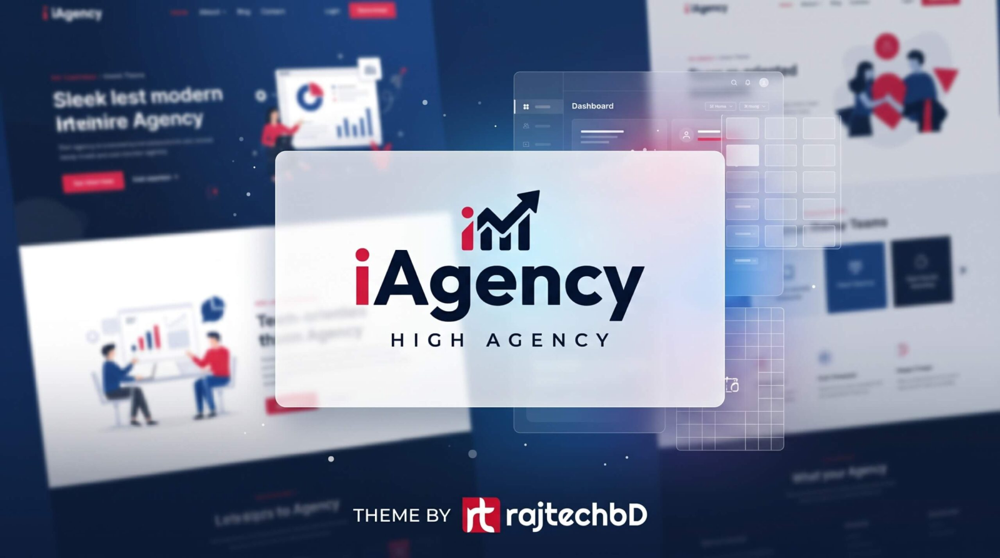

<div align="center">

# ⚡ iAgency — Enterprise WordPress Theme

### High-Performance Corporate WordPress Theme & Elementor System
**Engineered by [RajTech BD Limited](https://rajtechbd.com) • Dhaka, Bangladesh**

<p align="center">
  <a href="#-overview">Overview</a> •
  <a href="#-features">Features</a> •
  <a href="#-theme-preview">Preview</a> •
  <a href="#-architecture">Architecture</a> •
  <a href="#-quick-start">Quick Start</a> •
  <a href="#-payment-hub">Payment Hub</a> •
  <a href="#-contact">Contact</a>
</p>

[](https://wordpress.org)
[](https://www.php.net)
[](https://elementor.com)
[](https://tailwindcss.com)
[](https://rajtechbd.com)

---

### 🎨 Theme Thumbnail & Visual Showcase



*Official WordPress Theme Screenshot (`rajtechbd/screenshot.png` — 1600 × 893 Retina Display)*

---

</div>

## 🌐 Overview

**iAgency** is an elite, high-agency WordPress theme built specifically for modern digital agencies, enterprise software engineering houses, AI system developers, and ERP solution providers.

Crafted by **RajTech BD Limited** (Est. 2018 in Dhaka, Bangladesh), this theme fuses **8+ years of battle-tested enterprise engineering discipline** with **cutting-edge web performance and deterministic AI tooling**.

### 💡 Core Value Proposition
- ⚡ **Sub-200ms TTFB**: Lightweight architecture, zero bloated external vendor scripts, optimized asset loading.
- 🧩 **Dual Flexibility**: Native full-page WordPress templates (`front-page.php`, `page-payment-system.php`, etc.) combined with 100% **Elementor Visual Builder** drag-and-drop compatibility.
- 🎯 **Conversion-Optimized**: High-contrast typography, interactive micro-interactions, responsive drawer navigation, and rich schema markup.

---

## ✨ Key Features

```
┌────────────────────────────────────────────────────────────────────────┐
│                          iAgency CORE SUITE                           │
├───────────────────┬───────────────────┬────────────────────────────────┤
│ 🚀 Dynamic CPT    │ 💎 Multi-Channel  │ ⚡ Gutenberg &                 │
│    Portfolio Engine│    Payment Hub    │    Elementor Visual Builder    │
├───────────────────┼───────────────────┼────────────────────────────────┤
│ 🛡️ Strict NDA &   │ 📱 Responsive     │ 🔍 Structured Data             │
│    Code Ownership │    Glassmorphism  │    & Rich JSON-LD SEO          │
└───────────────────┴───────────────────┴────────────────────────────────┘
```

### 1. 📂 Dynamic Case Studies & Portfolio CPT
- Dynamic query for the top 3 latest published case studies on the homepage.
- Custom metadata: Client Entity, Delivery Year, Performance Impact (e.g., `99.9% Uptime`, `3.8x Speed`), and Tech Stack tags.
- Dedicated Single Portfolio template (`single-portfolio.php`) with SLA guarantees, scoping callout box, and adjacent project navigation.
- Dedicated Portfolio Archive (`archive-portfolio.php`).

### 2. 📰 Dynamic Technical Publications & Blog
- Dynamic query for the top 3 latest engineering insights on the homepage.
- Dynamic reading time calculator (`rajtechbd_get_reading_time()`).
- Dedicated Single Blog template (`single.php`) featuring Executive Briefs, Gutenberg content formatting, Author Profile box, and Related Insights grid.

### 3. 💳 Enterprise Multi-Channel Payment System (`/payment-system/`)
Dedicated financial transaction hub (`page-payment-system.php`) supporting 6 enterprise payment rails:
1. **Visa & International Cards**: 3D Secure 2.0, multi-currency processing (BDT, USD, EUR, GBP).
2. **Corporate Bank Wire (DBBL)**: Dutch-Bangla Bank Ltd corporate account, NPSB (instant), EFTN/BEFTN, RTGS (>৳100K), and SWIFT wire (`DBBLBDDH`).
3. **bKash Merchant**: Official Merchant Payment (`01758522846`, Counter 1), QR payment, Personal, and USSD `*247#`.
4. **Rocket (DBBL)**: Biller/Merchant ID (`01758522846`), 12-digit format, and USSD `*322#`.
5. **Nagad Merchant**: Postal Digital Financial Service Merchant (`01758522846`), Personal, and USSD `*167#`.
6. **Bank Cheque & Pay Order**: "Account Payee Only" corporate cheques drawn in favor of **RajTech BD Limited**.
- **Interactive Tools**: 1-click clipboard copy with toast feedback, live TrxID verification form with `wp_mail` integration, TDS/VDS compliance guides, and FAQ accordion.

### 4. ⚖️ Enterprise Legal & Compliance Suite
- **Privacy Policy (`page-privacy-policy.php`)**: Bank-grade data protection, strict Non-Disclosure Agreement (NDA) compliance, and AI data safeguards ensuring client data is never used to train public LLMs.
- **Terms & Conditions (`page-terms.php`)**: 100% client source code ownership upon final milestone delivery, 60-90 day bug-fix warranties, and 24/7 SLA governance under the laws of Bangladesh.

---

## 🗂️ Project Directory Structure

```plaintext
rajTechBD/
├── rajtechbd/                             # Complete WordPress Theme Directory
│   ├── screenshot.png                     # Official Theme Preview (1600 × 893)
│   ├── style.css                          # WordPress theme header declaration & resets
│   ├── functions.php                      # Theme setup, CPT registration & hooks
│   ├── header.php                         # Modern navigation with dropdown menus & CTA
│   ├── footer.php                         # 4-Column corporate footer with legal links
│   ├── front-page.php                     # Dynamic agency homepage
│   ├── single.php                         # Single blog article template
│   ├── single-portfolio.php               # Single case study template
│   ├── archive-portfolio.php              # Portfolio listing archive
│   ├── index.php                          # Blog archive fallback
│   ├── page.php                           # Default page container
│   ├── page-about.php                     # Corporate About Us template
│   ├── page-services.php                  # Enterprise Services & ERP systems template
│   ├── page-case-studies.php              # Case studies overview template
│   ├── page-faq.php                       # Interactive FAQ accordion template
│   ├── page-payment-system.php            # Enterprise multi-channel payment hub
│   ├── page-contact.php                   # Contact & project inquiry template
│   ├── page-privacy-policy.php            # Bank-grade privacy & NDA terms
│   ├── page-terms.php                     # Client IP ownership & service SLA
│   ├── template-elementor-fullwidth.php   # Elementor Full-Width canvas
│   ├── template-elementor-canvas.php      # Elementor Blank canvas
│   ├── 404.php                            # Custom 404 error page
│   ├── inc/                               # Theme helper functions
│   └── assets/                            # Compiled assets
│       ├── css/theme.css                  # Custom styling, animations & glassmorphism
│       ├── js/theme.js                    # Interaction scripts & accordion controllers
│       └── images/                        # Logos, icons & brand vectors
├── photo/                                 # High-resolution original design assets
│   └── Gemini_Generated_Image_d05clid05clid05c1-scaled.jpeg # Source thumbnail
├── generate_elementor_template.py         # Elementor JSON schema generator
├── generate_enhanced_html.py              # HTML generator
├── rajtechbd-homepage-elementor-template.json # Ready-to-import Elementor template
└── README.md                              # Repository Documentation
```

---

## 🚀 Quick Start & Installation

### Option 1: WordPress Admin Upload
1. Compress the `rajtechbd/` directory into a `.zip` file (or use `rajtechbd-theme.zip`).
2. Log into your WordPress Dashboard (`/wp-admin`).
3. Navigate to **Appearance > Themes > Add New Theme > Upload Theme**.
4. Choose the zip file and click **Install Now**.
5. Click **Activate**.

### Option 2: FTP / Direct Server Deployment
1. Upload the `rajtechbd/` directory to `/wp-content/themes/` on your server.
2. In WordPress Admin, navigate to **Appearance > Themes**.
3. Locate **RajTech BD Limited / iAgency** (featuring the custom thumbnail preview) and click **Activate**.

---

## 🎨 Elementor Template Import

To load the pre-built homepage template into Elementor:
1. In WordPress Admin, navigate to **Templates > Saved Templates > Import Templates**.
2. Upload [`rajtechbd-homepage-elementor-template.json`](file:///home/dev_shakib/Projects/rajTechBD/rajtechbd-homepage-elementor-template.json).
3. Create a new page, set the Template to **Elementor Full Width**, and insert the imported template from **My Templates**.

---

## 🏢 Corporate Entity & Contact

<div align="center">

**RajTech BD Limited**  
*Premier Software Engineering, Enterprise ERP, Modern Web & AI Systems*  
Incorporated in Bangladesh under the Companies Act, 1994  
Kuril, Vatara, Dhaka-1229, Bangladesh

| Channel | Detail |
|---|---|
| **Official Website** | [rajtechbd.com](https://rajtechbd.com) |
| **Primary Email** | [info@rajtechbd.com](mailto:info@rajtechbd.com) |
| **Secondary Email** | [rajtechbdt@gmail.com](mailto:rajtechbdt@gmail.com) |
| **Hotline / WhatsApp** | [+880 1758-522846](https://wa.me/8801758522846) |
| **GitHub** | [@shakib5560](https://github.com/shakib5560) |

<br />

<sub>© 2018 - 2026 RajTech BD Limited. All Rights Reserved.</sub>

</div>
